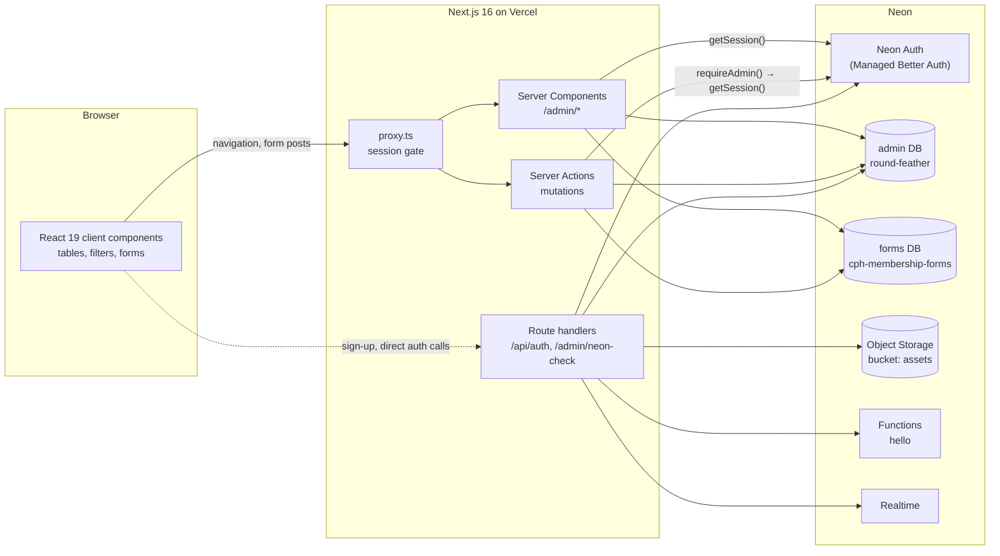
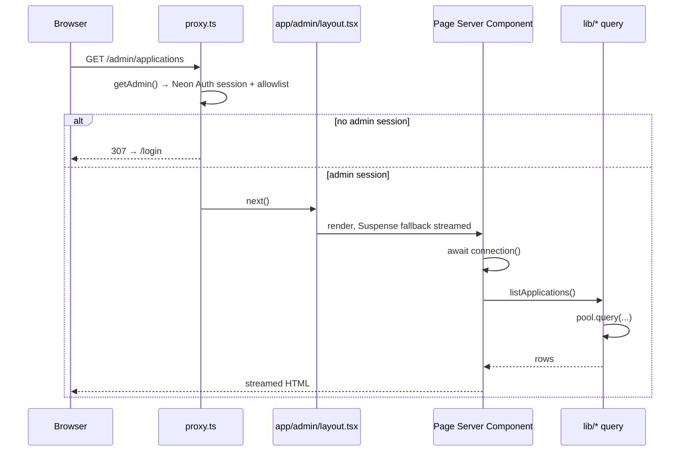
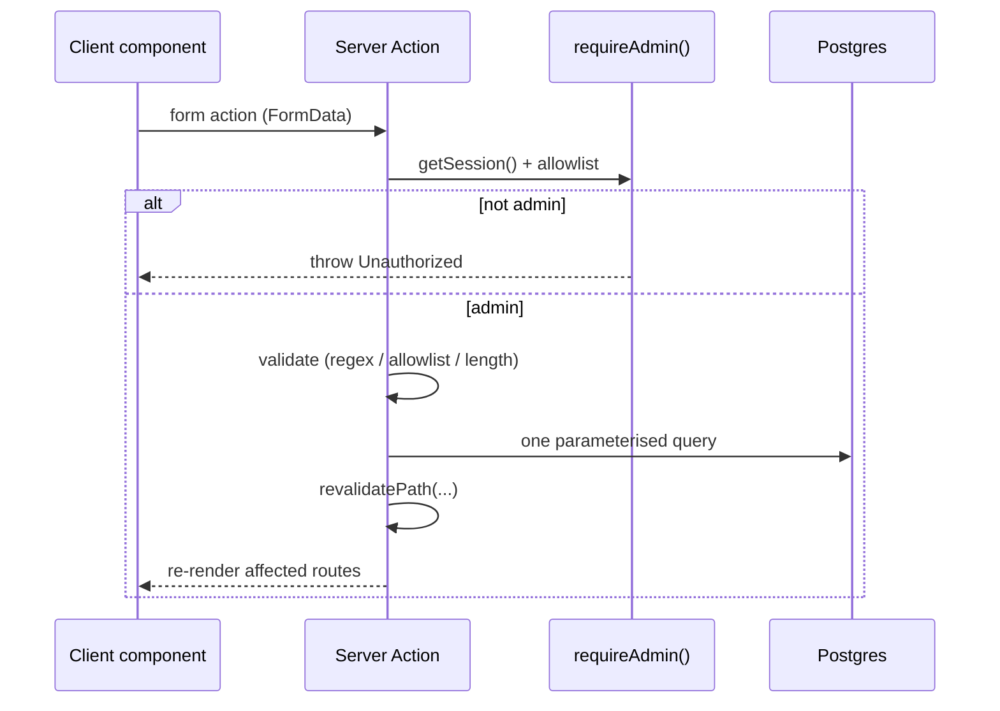

# Architecture

How the pieces fit together: two Postgres databases, one auth service, one Next.js deployment, and
the request path through them.

## System shape



Two rules explain almost all of the structure:

1. **Only the shell is static.** Every page that reads data is a static-looking Server Component
   wrapping an `async` child in `Suspense`, and that child awaits `connection()` first.
2. **Every mutation is a form post to a Server Action** that re-checks the admin allowlist.

## Processes

| Process | Where | Notes |
|---|---|---|
| Next.js server | Vercel | Renders Server Components, runs Server Actions and route handlers, holds two `pg` pools. |
| Postgres pools | In-process | `lib/neon.ts:10` and `lib/pg.ts:8`, both cached on `globalThis` so `next dev`'s HMR does not leak connections. |
| Neon Auth | Neon-managed | Issues and validates session cookies; users live in the `neon_auth` schema of the admin DB. |
| Neon Function `hello` | Neon-managed | Returns `"Hello from Neon Functions"`; pinged only by the health check. |
| Neon Realtime | Neon-managed | Server-side subscription used only by the health check. |
| Object Storage | Neon-managed | Private `assets` bucket; the health check round-trips one object. |

## Databases

The split is deliberate and is the single most confusing thing about the codebase, so it is
repeated in [Data model](04-data-model.md).

| | Admin DB | Forms DB |
|---|---|---|
| Env var | `DATABASE_URL` | `FORMS_DATABASE_URL` |
| Neon project | `round-feather-84347871` | `super-math` (`cph-membership-forms`) |
| Pool module | `lib/neon.ts` → `adminDb` | `lib/pg.ts` → `pool` |
| Schema file | `db/schema.sql` (this repo, applied here) | owned by the sibling repo |
| Tables used here | `members`, `deadlines`, `login_attempts`, plus Neon Auth's `neon_auth` schema | `applications`, `registration_personal_info`, `departments`, `department_roles`, `department_questions`, `department_answers` |
| Access | read + write | read, plus narrow writes (status, questions, open/closed) |

`lib/pg.ts` is deliberately more defensive than `lib/neon.ts`: it remembers which URL the pool was
built from and rebuilds the pool when `FORMS_DATABASE_URL` changes, which happens when you switch
branches during development.

## Request lifecycle

### Page load



`proxy.ts` only runs for `/`, `/login`, and `/admin/:path*` (`proxy.ts:14`). It is an optimisation
and a UX nicety, **not** the security boundary — see [Authentication](03-authentication.md).

### Mutation



Client components bind actions with `<form action={serverAction}>`; selects submit themselves via
`e.currentTarget.form?.requestSubmit()` (`app/admin/applications/status-select.tsx:17`).

### Health check

`GET /admin/neon-check` (`app/admin/neon-check/route.ts`) is the only route handler besides the auth
proxy. It awaits `connection()`, calls `requireAdmin()`, then runs four probes concurrently —
Postgres, Object Storage, Functions, Realtime — and answers `{ ok, results }` with HTTP 200 or 500.
Realtime is the only probe with side effects on the admin DB: it creates and then cleans up
`neon_healthcheck`.

## Rendering model

`next.config.ts` enables four things that shape the code style:

```ts
cacheComponents: true,       // static shells with dynamic holes
partialPrefetching: true,    // prefetch only what a link is likely to need
reactCompiler: true,         // automatic memoisation; no manual useMemo/useCallback
devIndicators: { position: "bottom-right" },
turbopack: { rules: { "*.css": { loaders: ["@tailwindcss/turbopack"] } } },
```

Consequences you will see repeated in every page:

- **`await connection()` before touching request data.** Without it, the surrounding tree can be
  prerendered at build time and Neon Auth throws a `cookies()` error. Examples:
  `app/admin/layout.tsx:25`, `app/admin/page.tsx:23`, `app/admin/applications/page.tsx:17`.
- **`Suspense` boundaries around data.** The static shell renders immediately with a fallback
  (`Loading…`, an empty table, an empty sidebar) and the data streams in. That is also why
  `sidebar.tsx` exports `SidebarView`, a pathname-less variant used as the fallback
  (`app/admin/layout.tsx:12`).
- **`PageProps<"/admin/applications/[id]">` / `LayoutProps<"/">`.** Next generates these global
  types; `params` is a `Promise` and must be awaited (`app/admin/applications/[id]/page.tsx:28`).
- **No manual memoisation.** The React Compiler handles it; `useState`, `useActionState`,
  `usePathname`/`useRouter`, and `toSorted` are the only client-side primitives in use.

## Directory map

```
app/
  layout.tsx                  root layout: Geist fonts, globals.css
  page.tsx                    redirect("/admin")
  globals.css                 Tailwind 4 theme, dot grid, watermark, tri-colour rule
  icon.png                    favicon
  login/
    page.tsx                  sign-in card
    login-form.tsx            client form, useActionState
    actions.ts                login (throttled), logout
  signup/
    page.tsx                  client-side account creation; grants no access
  api/auth/[...path]/route.ts Neon Auth handler, with POST /sign-in/email blocked
  admin/
    layout.tsx                sidebar + main column
    sidebar.tsx               nav, account block, logout
    page.tsx                  Overview: stats, tables, donut
    ui.tsx                    PageHeader, Panel, Status, th, td
    icons.tsx                 inline SVG icon set
    donut.tsx                 client donut chart with tooltip
    data.ts                   tools list, formatDate (Asia/Manila)
    applications/
      layout.tsx              page header + tabs
      tabs.tsx                Applicants | Form questions
      page.tsx                counts, per-department table
      applicants-table.tsx    filter, select, CSV export
      csv.ts                  RFC 4180 encoder with formula escaping
      row-link.tsx            clickable table row
      status-select.tsx       auto-submitting status select
      actions.ts              setApplicationStatus
      [id]/page.tsx           applicant detail
      questions/
        page.tsx              personal fields, open/close, question editor
        actions.ts            add/update/remove questions, open/close departments
        confirm-button.tsx    submit button with confirm()
    deadlines/                page, actions, table, status-select
    documents/                page, drive.ts (scraper), file-browser.tsx
    members/                  page, actions, members-table
    tools/page.tsx            external systems
    neon-check/route.ts       four-service health probe
lib/
  auth.ts                     allowlist + getAdmin + requireAdmin
  neon-auth.ts                server-side Neon Auth client
  neon-auth-client.ts         browser Neon Auth client
  login-limit.ts              lockout key, read, record, clear
  neon.ts                     adminDb, storage, functionUrl, realtimeServer
  pg.ts                       forms pool
  admin-data.ts               listMembers, listDeadlines
  applications.ts             listApplications, getApplication, listQuestions
  departments.ts              nine departments, incl. General Member (copy of the forms app's list)
  statuses.ts                 allowed values shared by server and client
db/schema.sql                 admin DB DDL + RLS
neon.ts                       @neon/config: auth, functions, buckets, realtime, branch policy
hello.ts                      the deployed Neon Function
proxy.ts                      session gate (Next 16 middleware replacement)
```

## Why these choices

- **Server Components by default.** Only thirteen files are `"use client"`: the login form, the
  sign-up page, the sidebar, the donut, the tabs, the applicant/member/deadline tables, the two
  status selects, the clickable row, the confirm button, and the file browser. Everything else is
  server-rendered HTML with no client JS.
- **Server Actions over an API layer.** There is no `/api/admin/*`. Each form posts to the action
  that owns it, next to the page that uses it. The trade-off is that actions are public POST
  endpoints, which is why each one starts with `requireAdmin()`.
- **Two pools, no ORM.** Queries are hand-written SQL with `$1` parameters. The schemas are small
  and the joins are explicit (`lib/applications.ts:20-27`), so an ORM would add indirection without
  removing work.
- **Status vocabularies in code, constraints in SQL.** `lib/statuses.ts` is imported by both server
  actions and client components; the same values appear in `db/schema.sql` `CHECK` constraints.
  They must be changed together.

---

Next: [Authentication →](03-authentication.md)
