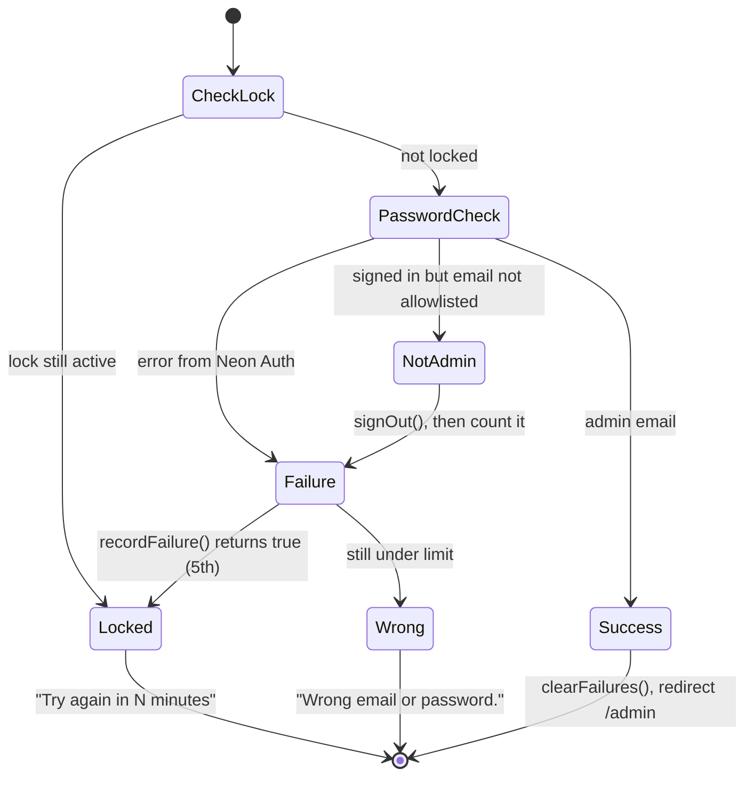

# Authentication and access control

Session handling, the admin allowlist, the login lockout, and the four places a request is checked.

## The model in one table

| Question | Answer | Where |
|---|---|---|
| Who can sign in? | Anyone with a Neon Auth account. | `app/signup/page.tsx`, `/api/auth` |
| Who can reach `/admin`? | Only emails in `ADMIN_EMAILS`. | `lib/auth.ts:4` |
| How is that checked on navigation? | `proxy.ts` matcher. | `proxy.ts:13-15` |
| How is that checked on mutations? | `requireAdmin()` in every Server Action. | `lib/auth.ts:16-18` |
| How is brute force limited? | 5 failures per `ip\|email` → 30-minute lock. | `lib/login-limit.ts` |

There is no roles table, no invites, and no per-department permissions. Admin is a single boolean
derived from an email string.

## The allowlist

```ts
// lib/auth.ts
export const ADMIN_EMAILS = ["learncyberph@gmail.com"];
export const isAdminEmail = (email: string) => ADMIN_EMAILS.includes(email.trim().toLowerCase());
```

Both sides are lowercased and trimmed, so casing and stray spaces never matter. Adding an admin is
a code change and a deploy; there is intentionally no UI for it.

`getAdmin()` (`lib/auth.ts:9-13`) is the only thing that turns a session into an admin:

```ts
const { data } = await neonAuth.getSession();
const user = data?.user;
return user && isAdminEmail(user.email) ? user : null;
```

A signed-in non-admin gets `null`, identical to a signed-out visitor. Nothing in the UI can
distinguish the two, and `/admin` sends both to `/login`.

`requireAdmin()` throws `Unauthorized` instead of redirecting, because it runs inside Server
Actions where a redirect would be swallowed as a successful form post.

## The three enforcement layers

```mermaid
flowchart TD
  A[Request] --> B{proxy.ts matcher?}
  B -->|"/", "/login", "/admin/*"| C{getAdmin}
  B -->|other paths| Z[Next.js handles it]
  C -->|null| D[redirect /login]
  C -->|admin on /login| E[redirect /admin]
  C -->|admin| F[Render page]
  F --> G[Page/layout may read session again]
  G --> H[User submits a form]
  H --> I{Server Action: requireAdmin}
  I -->|fail| J[throw Unauthorized]
  I -->|pass| K[validate + query]
```

1. **`proxy.ts`** — a redirect gate for navigations. Next 16 renamed middleware to `proxy`; the
   file exports `proxy` and a `config.matcher` limited to `/`, `/login`, and `/admin/:path*`. It
   performs a session lookup on every match, so it is a real cost on each navigation, not a cached
   header check.
2. **Page-level reads** — `app/admin/layout.tsx:26` re-reads the admin to render the sidebar account
   block. This is presentation only; the layout does not block anything itself.
3. **`requireAdmin()` in actions and route handlers** — the actual boundary for writes.
   `app/admin/neon-check/route.ts:76` does the same, with a comment explaining that route handlers
   are endpoints too.
4. **The blocked auth route** — `app/api/auth/[...path]/route.ts:10-12` refuses
   `POST …/sign-in/email` with a 404 JSON body, so password guessing cannot bypass the lockout by
   calling Neon Auth directly from a script.

## Login flow



Step by step (`app/login/actions.ts:12-31`):

1. `email` is trimmed and lowercased; `password` is taken verbatim.
2. The client IP is the first entry of `x-forwarded-for`, or `"unknown"`. The lockout key is
   `ip|email` (`lib/login-limit.ts:9`), so one attacker cannot lock the real admin out from another
   address.
3. `lockedMinutes(key)` is checked **before** calling Neon Auth, so a locked pair costs no upstream
   request. The query rounds up to whole minutes.
4. `neonAuth.signIn.email` is called for **every** email, including non-allowlisted ones. This is
   deliberate: it keeps the response time of a wrong email and a wrong password indistinguishable.
   (An earlier version returned early for unknown emails, which leaked the admin address through
   timing — see [Conventions and gotchas](09-conventions-and-gotchas.md).)
5. On failure — an auth error, or a successful sign-in for a non-allowlisted email — the session is
   discarded (`signOut()`), the failure is recorded, and the same message is returned unless the
   failure was the fifth.
6. On success the counters are deleted and the action redirects to `/admin`.

Both failure branches share one message string, `Wrong email or password.` Only the lockout message
names a reason, and by then the attacker already knows they are being throttled.

## The lockout

`lib/login-limit.ts` keeps state in the admin DB:

```sql
CREATE TABLE login_attempts (
  key          text PRIMARY KEY,   -- "ip|email"
  failures     int NOT NULL DEFAULT 0,
  locked_until timestamptz
);
```

`recordFailure` is a single upsert (`lib/login-limit.ts:23-29`): it increments the counter, and when
the increment reaches `MAX_FAILURES` (5) it **resets the counter to 0 and sets** `locked_until` to
now + 30 minutes. Resetting matters: after a lock expires the user gets a fresh five attempts rather
than one.

`clearFailures` deletes the row on a successful sign-in. Rows for abandoned keys stay in the table;
that is harmless and cheap.

| Constant | Value | Effect |
|---|---|---|
| `MAX_FAILURES` | 5 | Failures in a row before a lock. |
| `LOCK_MINUTES` | 30 | Lock duration, surfaced as "Try again in N minutes". |

This is a per-`ip|email` throttle, not a global account lock. A distributed attacker rotating IPs
gets five guesses per address per IP. Wide-scale password spraying is not addressed; the mitigation
in place is that only one email can ever reach `/admin`.

## Account creation

`/signup` is a client-side page (`"use client"` at `app/signup/page.tsx:1`) that calls
`authClient.signUp.email({ name, email, password })` against the same-origin `/api/auth` proxy. It
enforces `minLength={8}` in the browser; Neon Auth enforces its own rules server-side.

Creating an account grants nothing. There is no link from `/login` to `/signup`, and the page's own
comment says so: *"It does not grant access to /admin (that still uses the admin login)."*

Neon Auth also rejects a sign-up whose email already exists, which is what prevents someone from
registering the admin address before the real admin does (after the same lowercasing the allowlist
uses).

## Sign-out

`logout` (`app/login/actions.ts:33-36`) calls `neonAuth.signOut()` and redirects to `/login`. It is
bound directly as a form action in the sidebar (`app/admin/sidebar.tsx:36`), on both the mobile
header and the desktop account block. Because it is a Server Action, it is a POST endpoint — but it
only ever destroys the caller's own session, so `requireAdmin()` is unnecessary.

## Session storage

`lib/neon-auth.ts` creates the server client from two variables:

```ts
export const neonAuth = createNeonAuth({
  baseUrl: process.env.NEON_AUTH_BASE_URL!,
  cookies: { secret: process.env.NEON_AUTH_COOKIE_SECRET! },
});
```

- Users and sessions live in the `neon_auth` schema of the admin database, not in this app's tables.
- The session cookie is a signed JWT; `NEON_AUTH_JWKS_URL` supplies the verification keys.
- `lib/neon-auth-client.ts` creates the browser client with no arguments — it talks to the
  same-origin `/api/auth` proxy, which forwards `GET`, `PUT`, `DELETE`, and `PATCH` to Neon Auth and
  filters `POST`.

## What is *not* implemented

Documenting the gaps is part of the design:

- **No multi-admin management.** One literal array in source.
- **No MFA, no password reset UI.** Both are Neon Auth's hosted responsibility; this app never
  touches them.
- **No CSRF token of its own.** Next.js Server Actions are POST-only and protected by the framework's
  origin check; the auth proxy relies on cookie-signed requests.
- **No audit log.** Status changes overwrite the row; nothing records who changed what.
- **No session revocation.** Signing out clears the cookie; a stolen cookie stays valid until it
  expires.

---

Next: [Data model →](04-data-model.md)
