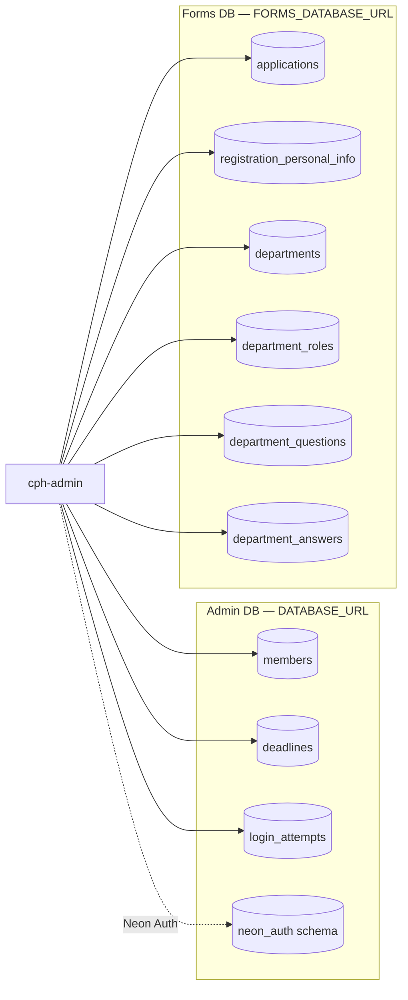
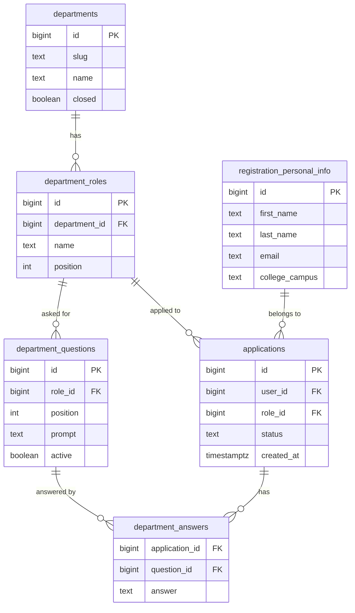
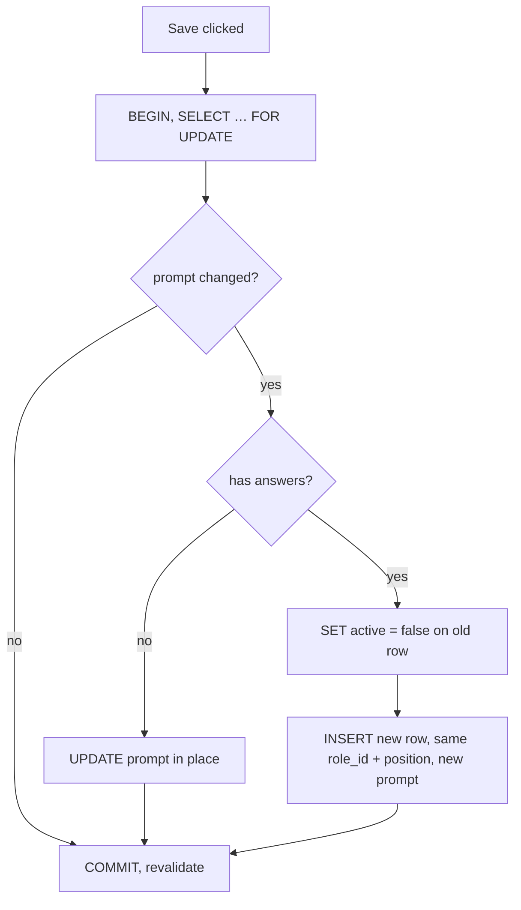

# Data model

Everything the app reads or writes, in the two databases it touches.

The admin database schema is authoritative in this repo (`db/schema.sql`). The forms database is
owned by the sibling `cph-membership-forms` project; this page describes only the columns and
relationships this app depends on, as evidenced by the queries in `lib/applications.ts`.

## Database split



## Admin database

### `members`

```sql
CREATE TABLE IF NOT EXISTS members (
  id         bigint GENERATED ALWAYS AS IDENTITY PRIMARY KEY,
  name       text NOT NULL,
  department text NOT NULL,
  college    text,              -- optional; blank is stored as NULL
  position   text NOT NULL,     -- free text: "Chief of Staff", "VP for Creatives"
  category   text NOT NULL      -- fixed group, drives filtering and sort order
);
```

The history in the file is worth knowing, because the `ALTER` statements are load-bearing:

| Statement | Why |
|---|---|
| `DROP CONSTRAINT members_position_check` | `position` used to be limited to the same values as `category`; it is now free text. |
| `ALTER COLUMN college DROP NOT NULL` | College became optional. |
| `ADD COLUMN IF NOT EXISTS category` | Category was added after the first version. |
| `DROP/ADD CONSTRAINT members_category_check` | Re-created on every run, so editing the list here is enough. |

The category constraint allows exactly five values, and must stay in sync with
`lib/statuses.ts:2`:

```
Executive · Consultant · Lead · Chapter Lead · Ambassador
```

`department` is free text and is **not** a foreign key to the forms DB's `departments` table. A
member's department string and an application's department name are compared only in the dashboard
chart, by name.

`listMembers()` (`lib/admin-data.ts:9-16`) orders by
`array_position($1::text[], category), name`, passing `MEMBER_CATEGORIES` as the array — so the
display order is the order in the constant, not alphabetical. The client table re-sorts on top of
that.

### `deadlines`

```sql
CREATE TABLE IF NOT EXISTS deadlines (
  id     bigint GENERATED ALWAYS AS IDENTITY PRIMARY KEY,
  title  text NOT NULL,
  owner  text NOT NULL,                                   -- labelled "Department" in the UI
  due    date NOT NULL,
  status text NOT NULL DEFAULT 'Open'
         CHECK (status IN ('Open', 'In Progress', 'Done'))
);
```

`owner` is a free-text label, despite the UI calling it "Department". There is no delete or edit.
`listDeadlines()` selects `due::text` so the value travels as `"2026-11-14"` and
`formatDate` cannot shift it by the server's time zone (`lib/admin-data.ts:20-23`).

### `login_attempts`

```sql
CREATE TABLE IF NOT EXISTS login_attempts (
  key          text PRIMARY KEY,   -- "ip|email"
  failures     int NOT NULL DEFAULT 0,
  locked_until timestamptz
);
```

Used only by `lib/login-limit.ts`. See [Authentication](03-authentication.md#the-lockout) for the
upsert that drives it.

### Row-level security

The last block of `db/schema.sql` runs a `DO` loop over all three tables:

```sql
EXECUTE format('ALTER TABLE %I ENABLE ROW LEVEL SECURITY', t);
EXECUTE format('ALTER TABLE %I FORCE ROW LEVEL SECURITY', t);
EXECUTE format('REVOKE ALL ON %I FROM PUBLIC', t);
EXECUTE format('DROP POLICY IF EXISTS admin_only ON %I', t);
EXECUTE format('CREATE POLICY admin_only ON %I FOR ALL TO neondb_owner USING (true) WITH CHECK (true)', t);
```

Reading it line by line:

- `ENABLE` turns RLS on for non-owners.
- `FORCE` extends RLS to the table owner too, so even `neondb_owner` is subject to policies.
- `REVOKE ALL FROM PUBLIC` removes the default grants.
- The single `admin_only` policy allows `neondb_owner` everything, and the owner is the role in
  `DATABASE_URL`. `USING (true)` and `WITH CHECK (true)` mean "all rows, no predicates".

The net effect: any role other than `neondb_owner` — the Data API roles, a token role, a stray
connection string — has no grant and no policy, so it sees nothing. Because the application always
connects as the owner, it is unaffected. This is defence against accidental sharing of the
database, not against the application.

> **Gotcha:** `FORCE ROW LEVEL SECURITY` has one important exception in practice — Realtime's probe
> in `app/admin/neon-check/route.ts:49` creates `neon_healthcheck` *without* enabling RLS, because
> Realtime refuses to watch a table with RLS on. That table is disposable and holds random UUIDs.

### Neon Auth tables

Not in `db/schema.sql`. Neon Auth creates and manages a `neon_auth` schema in the same database:
users, sessions, accounts, verification tokens. Treat it as owned by the service; do not write to
it from application code.

## Forms database

Relationships as this app uses them:



### Columns this app depends on

| Table | Columns read/written here |
|---|---|
| `applications` | `id`, `user_id`, `role_id`, `status`, `created_at`, `team`, `interview_at`; writes `status` only |
| `registration_personal_info` | `id`, `first_name`, `last_name`, `email`, `pup_webmail`, `phone`, `discord_username`, `facebook_link`, `facebook_shared_post`, `linkedin_link`, `course_year_section`, `certificate_link`, `college_campus` |
| `departments` | `id`, `slug`, `name`, `closed`; writes `closed` |
| `department_roles` | `id`, `department_id`, `name`, `position`, `category`, `teams`, `interview`; writes nothing |
| `department_questions` | `id`, `role_id`, `position`, `prompt`, `active`; writes all but `id` on insert |
| `department_answers` | `application_id`, `question_id`, `answer`; read only |

`applications.status` is **free text** in the forms DB (no `CHECK`), lowercase, with `"pending"` as
the value the forms app inserts. This app narrows it to four values via `APPLICATION_STATUSES`
(`lib/statuses.ts:5`) and refuses anything else in `setApplicationStatus`.

`pup_webmail` is legacy: older applicants were asked for it, newer ones are not. The detail page
only renders the row when a value exists (`app/admin/applications/[id]/page.tsx:45`).

### Query shapes

Three queries matter, and all three are worth reading in full:

**`listApplications()`** (`lib/applications.ts:19-30`) joins application → personal info → role →
department and sorts newest first. The department comes from `departments d JOIN department_roles r`
on `r.department_id`, *not* from a column on the application:

```sql
FROM applications a
JOIN registration_personal_info p ON p.id = a.user_id
JOIN department_roles r ON r.id = a.role_id
JOIN departments d ON d.id = r.department_id
ORDER BY a.created_at DESC, a.id DESC
```

**`getApplication(id)`** (`lib/applications.ts:32-66`) runs the same join for one row, plus a second
query for answers joined to the *current* prompt text, ordered by `q.position, q.id`. Because the
question join starts from `department_answers`, an answer to a question that was later deactivated
still shows the wording it was answered under — no `active` filter is applied there.

**`listQuestions()`** (`lib/applications.ts:79-90`) drives the editor. It walks **all** departments
and roles with `LEFT JOIN department_questions … AND q.active`, so a role with zero questions still
appears, and pairs each question with a live count of its answers. Ordering is
`d.id, r.position, r.id, q.position, q.id`.

### The question-versioning rule

Answers point at a question row. If the wording of a question were edited in place, every past
answer would silently appear to answer the new wording. The forms DB therefore treats questions as
immutable versions, and this app enforces the same rule in `updateQuestion`
(`app/admin/applications/questions/actions.ts:23-57`):



Three details that are easy to break:

- The row is locked `FOR UPDATE` inside a transaction, so two admins saving at once cannot both
  create a replacement version.
- The replacement copies `position` from the old row, so the question keeps its slot in the form
  ordering (`ORDER BY position, id`).
- If the question is no longer `active`, the action throws "That question no longer exists.
  Reload the page." rather than resurrecting it.

`removeQuestion` is also a soft delete (`active = false`), never a `DELETE`, for the same reason:
answers may reference the row.

`addQuestion` computes `COALESCE(max(position), 0) + 1` for the role in the insert's `SELECT`, so a
new question lands at the end without a separate round trip.

### Department open/closed

`departments.closed` is the only switch the forms app reads to decide whether a department can be
picked and whether a submission is accepted. Two actions write it:
`setDepartmentClosed` (one slug) and `setAllDepartmentsClosed` (all rows). Both are validated only
by `rowCount` — a slug that no longer exists raises rather than silently doing nothing.

The nine departments themselves (including `member`, "General Member") live in `lib/departments.ts`, copied from
`cph-membership-forms/app/register/departments.ts`. That file is the source of the `slug` value used
by `setDepartmentClosed`, so **a slug rename in the forms app breaks the toggle here**.

---

Next: [Admin features →](05-admin-features.md)
